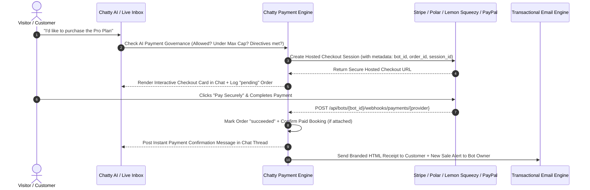

export const metadata = {
  title: "Payment Gateways, Webhooks & Receipt Emails",
  description: "Connect Stripe, PayPal, Lemon Squeezy, and Polar.sh with AI payment governance rules, automatic webhooks, and branded customer receipt emails.",
}

import { Note, Tip, Warning, Info } from "@/components/mdx/Callout"
import { Card, CardGroup } from "@/components/mdx/Card"
import { Accordion, AccordionGroup } from "@/components/mdx/Accordion"
import { PageNav } from "@/components/PageNav"
import { prevNext } from "@/lib/navigation"

# Payment Gateways, Webhooks & Receipt Emails

Chatty enables your AI agent and human support team to close sales, collect consultation deposits, and sell subscriptions directly inside chat conversations across Web, WhatsApp, Instagram, Messenger, Telegram, and SMS.

Whether you process payments with **Stripe**, **Polar.sh**, **Lemon Squeezy**, or **PayPal**, Chatty provides an end-to-end production pipeline:
1. **In-Chat Hosted Checkout Cards** (`[CHECKOUT_LINK:{...}]`)
2. **Centralized AI Payment & Checkout Governance** (autonomous caps, discount rules, and lead requirements configured right inside your Payment Gateway view)
3. **Automatic & Manual Gateway Webhooks** (`/api/bots/{bot_id}/webhooks/payments/{provider}`)
4. **Automated Customer Receipt & Status Emails** with a live **Receipt & Email Designer** in both the **Integrations** and **Orders & Sales** tabs

---

## Supported Gateways

<CardGroup cols={2}>
  <Card title="Stripe" icon="💳">
    Direct card processing, Apple Pay, Google Pay, SEPA, and 40+ payment methods via Stripe Hosted Checkout. Supports 1-click automatic webhook registration.
  </Card>
  <Card title="Polar.sh" icon="🐻">
    Developer-first Merchant of Record for SaaS tiers, digital products, license keys, and recurring subscriptions. Supports Organization Access Tokens (`polar_oat_...`) and automatic webhooks.
  </Card>
  <Card title="Lemon Squeezy" icon="🍋">
    Merchant of Record (MoR) platform handling global sales tax, EU VAT, invoicing, and cross-border digital compliance automatically.
  </Card>
  <Card title="PayPal" icon="🅿️">
    PayPal balance, credit/debit cards, and Pay Later through a hosted PayPal Orders v2 approval flow with automatic webhook registration.
  </Card>
</CardGroup>

---

## End-to-End Payment & Receipt Flow



---

## Centralized AI Payment & Checkout Governance

All AI payment rules and safety guardrails live directly inside **Dashboard → Integrations → [Your Payment Gateway]** (rather than buried in general Agent Settings), and apply uniformly across all connected payment gateways:

<AccordionGroup>
  <Accordion title="1. Autonomous AI Checkout Toggle (AI Permitted vs AI Restricted)">
    - **AI Permitted (`ai_payment_allowed = true`)**: Your AI agent can autonomously call `create_payment_checkout_link` during conversations when a customer asks to buy a product, pay an invoice, or book a paid consultation.
    - **AI Restricted (`ai_payment_allowed = false`)**: The AI agent is strictly blocked from generating payment links (`403 Forbidden` at the service boundary) and instead informs the buyer that a human specialist will dispatch a verified checkout link from the **Live Inbox**.
  </Accordion>
  <Accordion title="2. Maximum Autonomous Transaction Cap ($)">
    Set a dollar ceiling (e.g., `$250`). Any checkout request up to `$250` is generated autonomously by the AI agent, while higher-ticket deals automatically escalate to your human sales team in the Inbox.
  </Accordion>
  <Accordion title="3. AI Payment & Checkout Directives (Custom Rules & Presets)">
    Provide natural-language commercial rules that are injected directly into the AI agent's system prompt whenever payment tools are active. You can also click any of the **Quick-Insert Presets**:
    - 🛡️ **Require Lead Info First**: Always collect Full Name, Business Email, and Phone before generating a checkout link.
    - 🏷️ **10% Courtesy Discount Cap**: Authorize up to a 10% courtesy discount only if the visitor objects to price.
    - 💼 **Escalate Deals > $500**: Invite enterprise buyers to book a strategy call rather than sending a self-serve link.
    - 🔄 **14-Day Refund Guarantee**: Proactively mention your refund policy before checkout.
    - ⚡ **Instant Order Confirmation**: Acknowledge payment completion and inform the buyer that their receipt was emailed.
  </Accordion>
</AccordionGroup>

---

## Webhook Setup: Automatic vs. Manual Configuration

Real-time webhooks allow Stripe, Polar.sh, Lemon Squeezy, and PayPal to notify Chatty the instant a customer completes checkout or receives a refund.

### Your Dedicated Webhook Endpoint URL

Every connected payment gateway displays its dedicated webhook endpoint inside **Dashboard → Integrations → [Provider]**:

```text
POST https://api.chatty.personaliai.com/api/bots/{bot_id}/webhooks/payments/{provider}
```
*(where `{provider}` is `stripe`, `polar`, `lemonsqueezy`, or `paypal`)*

### 1. Automatic Webhook Registration (1-Click)

When you click **Verify & Connect** (or click the **Auto-Register Webhook** button on an already-connected gateway), Chatty automatically calls the payment provider's API to:
1. Check if the webhook endpoint is already registered on your account (preventing duplicate endpoints).
2. Register `https://api.chatty.personaliai.com/api/bots/{bot_id}/webhooks/payments/{provider}` for all required payment & refund events.
3. Retrieve and encrypt the provider's **Webhook Signing Secret** (`whsec_...` or HMAC secret) in `chatty_payment_integrations`.

When automatic registration succeeds, you will see the green **Auto-Registered** badge next to your webhook URL.

### 2. Manual Webhook Setup Guide (Fallback)

If your API token is scoped as read-only or lacks webhook management permissions (for example, a Polar.sh token created without `webhooks:write`), you can configure the webhook manually in 60 seconds:

- **Stripe**:
  1. Open **Stripe Dashboard → Developers → Webhooks → Add endpoint**.
  2. Paste your **Webhook Endpoint URL** from Chatty.
  3. Select events: `checkout.session.completed`, `payment_intent.succeeded`, `payment_intent.payment_failed`, and `charge.refunded`.
  4. Copy the **Signing secret (`whsec_...`)** and paste it into the Stripe integration card in Chatty.
- **Polar.sh**:
  1. Open **Polar.sh Dashboard → Settings → Webhooks → Add Endpoint**.
  2. Paste your **Webhook Endpoint URL** and select payload format **RAW (JSON)**.
  3. Enable events: `checkout.updated`, `order.created`, `order.paid`, and `order.refunded`.
  4. *(Tip: Enable the `webhooks:write` scope on your `polar_oat_...` token to let Chatty register this automatically with 1 click.)*
- **Lemon Squeezy**:
  1. Open **Lemon Squeezy Dashboard → Settings → Webhooks → + Create Webhook**.
  2. Paste your **Webhook Endpoint URL** into the Callback URL field.
  3. Select events: `order_created`, `order_refunded`, `subscription_payment_success`, and `subscription_payment_failed`.
- **PayPal**:
  1. Open [developer.paypal.com](https://developer.paypal.com/dashboard/applications), select your REST App, and scroll to **Webhooks → Add Webhook**.
  2. Paste your **Webhook Endpoint URL**.
  3. Enable events: `CHECKOUT.ORDER.APPROVED`, `PAYMENT.CAPTURE.COMPLETED`, `PAYMENT.CAPTURE.REFUNDED`, and `PAYMENT.CAPTURE.DENIED`.

---

## Automated Customer Receipt Emails & Email Designer

Whenever a payment succeeds or an order status changes (`succeeded`, `refunded`, `failed`), Chatty automatically sends a responsive, branded HTML email to the customer (and an optional **New Sale Alert** to the bot owner).

### Customizing Your Receipt & Status Email Design

You can customize and preview your transactional order emails from two convenient places:
- **Dashboard → Integrations → [Stripe / Polar / Lemon Squeezy / PayPal] → Automated Payment Receipt & Status Emails**
- **Dashboard → Orders & Sales → Receipt & Email Design** button (top right header)

#### Configurable Design Options:
- **Customer Receipts Toggle**: Automatically email buyers when their payment is confirmed, refunded, or fails.
- **Owner Sale Alert Toggle**: Send an instant revenue notification email to the bot owner whenever a checkout succeeds.
- **Brand Header Color**: Choose any hex color (or quick swatch) for the email header banner and callout borders.
- **Support Reply-To Email**: Displayed in the receipt footer and configured as the `Reply-To` header so customers can reply directly to your support team.
- **Custom Receipt Note / Onboarding Instructions**: Add a custom message box inside the receipt (e.g., *"Thank you for your purchase! Your license key and onboarding call link will arrive within 5 minutes."*).
- **Live Interactive Preview**: Switch between **Paid Receipt**, **Refund Issued**, and **Payment Link** tabs to preview the exact HTML layout before saving.

### Resending Receipts or Emailing Status Updates Manually

In **Dashboard → Orders & Sales**:
1. Click the **Mail icon (`✉️`)** on any transaction row to immediately send or resend the current receipt/status email to the customer.
2. Or click any transaction row to open the **Transaction Dossier** drawer, enter or update the recipient email address under **Customer Email Dispatch**, and click **Send Receipt Email**.
3. Clicking **Mark Paid & Email Receipt** or **Mark Refunded & Email** inside the drawer updates the audit status and automatically dispatches the corresponding email notification to the buyer.

---

<PageNav {...prevNext("/guides/payment-gateways")} />
