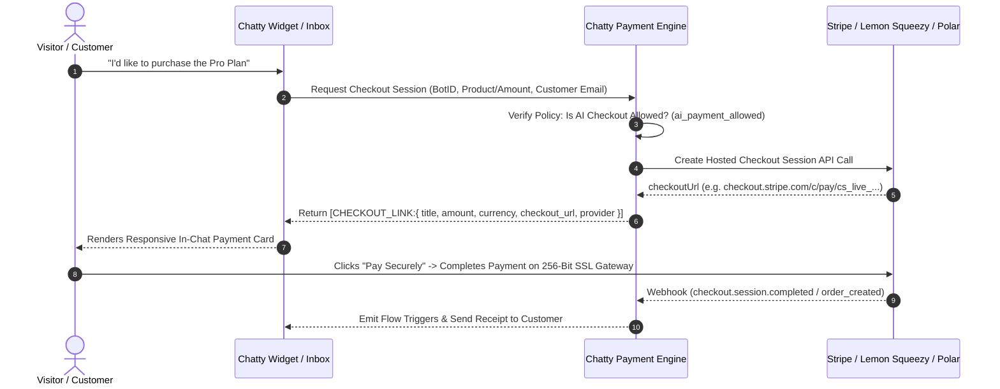

export const metadata = {
  title: "Payment Gateways & In-Chat Checkouts",
  description: "Connect Stripe, PayPal, Lemon Squeezy, and Polar.sh to sync product catalogs and dispatch secure in-chat checkout cards with AI safety policies.",
}

import { Note, Tip, Warning, Info } from "@/components/mdx/Callout"
import { Card, CardGroup } from "@/components/mdx/Card"
import { Accordion, AccordionGroup } from "@/components/mdx/Accordion"
import { PageNav } from "@/components/PageNav"
import { prevNext } from "@/lib/navigation"

# Payment Gateways & In-Chat Checkouts

Chatty allows your team and AI agents to close deals, collect consultation deposits, and sell products directly within chat threads. Customers never have to leave the conversation or click obscure external links—they receive an interactive, PCI-compliant checkout card right in the message flow.

Whether you bill via **Stripe**, accept **PayPal**, use **Lemon Squeezy** as a Merchant of Record for global digital tax compliance, or run a developer SaaS on **Polar.sh**, Chatty automatically syncs your existing product pricing plans and provides one-click dispatch from both the Live Agent Inbox and automated workflows.

---

## Supported Gateways

<CardGroup cols={2}>
  <Card title="Stripe" icon="💳">
    Direct card processing, Apple Pay, Google Pay, SEPA, and 40+ local payment methods via Stripe Hosted Checkout.
  </Card>
  <Card title="PayPal" icon="🅿️">
    PayPal balance, cards, and Pay Later through a hosted PayPal approval page (Orders v2). Custom amounts only; PayPal has no one-time price catalog.
  </Card>
  <Card title="Lemon Squeezy" icon="🍋">
    Merchant of Record (MoR) platform handling global sales tax, VAT, invoicing, and cross-border digital compliance automatically.
  </Card>
  <Card title="Polar.sh" icon="🐻">
    Developer-centric monetization for SaaS tiers, open-source sponsorship, license keys, and recurring subscriptions.
  </Card>
</CardGroup>

---

## How In-Chat Checkouts Work

Chatty generates PCI-compliant hosted checkout sessions and renders them as branded interactive cards in chat using the format `[CHECKOUT_LINK:{...}]`.

---

## Two Checkout Modes: Catalog Sync vs Custom Amount

When dispatching payment requests from the **Live Agent Inbox**, agents have two powerful options:

### 1. Synced Products & Pricing Plans
Chatty connects directly to your payment gateway's API and automatically imports all your active products, variants, and pricing tiers:
- **Stripe**: Queries active prices and expanded product objects (`/v1/prices?expand[]=data.product`).
- **Lemon Squeezy**: Fetches store products, descriptions, and variant price configurations (`/v1/products?include=variants`).
- **Polar.sh**: Queries active products, recurring intervals, and custom pricing schemes (`/v1/products`).
- **PayPal**: No catalog sync. PayPal does not store prices for one-time products, so use Custom One-Time Amount.

Agents can search the catalog in real-time, inspect formatted prices, and click once to generate a branded checkout link tied directly to that plan.

### 2. Custom One-Time Amount
For ad-hoc custom scopes, emergency retainers, or tailored quotes:
- Enter any custom line-item title (e.g. *"2-Hour Architecture Advisory"*).
- Specify the exact amount (minimum $0.50).
- Select any supported billing currency (USD, EUR, GBP, CAD, AUD, etc.).
- Chatty instantly spins up a secure one-off payment session.

<Warning>
**Lemon Squeezy limitation:** Lemon Squeezy cannot create products from code. A custom amount overrides the price of an *existing* product variant, so Chatty attaches it to the variant you pick (or your first synced one). Keep at least one published product in your store, otherwise custom-amount checkouts return an error.
</Warning>

---

## In-Chat Checkout Card Anatomy

The customer receives a clean, mobile-responsive card embedded right inside their message stream:

- **Provider Badge**: Clearly displays whether the link is powered by Stripe, Lemon Squeezy, or Polar.
- **Plan Title & Amount**: Displays the exact line item name and formatted price (e.g., `$49.00 USD`).
- **Recurring / One-Time Indicator**: Clearly indicates if the payment is a monthly subscription or a one-off deposit.
- **Pay Securely CTA**: Opens the PCI-DSS Level 1 hosted checkout window.
- **Encrypted Trust Seals**: Reinforces consumer trust with 256-bit SSL and Level 1 PCI badges.

<Tip>
When a visitor is already identified (e.g., entered their email in a lead capture form or logged into your portal), Chatty pre-populates the customer's email in the checkout session so they don't have to retype it.
</Tip>

---

## AI Agent Payment Safeguards & Human Takeover

Autonomous AI agents handling money require strict boundaries. To prevent prompt injection exploits, accidental misquoting, or unapproved discounts, Chatty implements a **multi-tiered policy engine**:

<AccordionGroup>
  <Accordion title="Autonomous AI Checkout Policy (ai_payment_allowed)">
    By default, you can restrict payment generation so that **only verified human agents** in the Live Inbox can dispatch checkout links. 
    
    If disabled, any attempt by an autonomous bot prompt or AI tool invocation to generate a payment session is blocked with a `403 Forbidden` at the service boundary.
  </Accordion>
  <Accordion title="Maximum AI Transaction Ceiling (ai_max_amount_cents)">
    When AI payments are permitted, you can set a hard cap (e.g., maximum $100.00). Any automated transaction exceeding this ceiling is aborted and escalated to human takeover.
  </Accordion>
  <Accordion title="Automated Escalation to Live Inbox">
    If an AI bot encounters a visitor who is ready to purchase but AI payment generation is turned off, the conversation is automatically tagged `needs_payment_dispatch` and prioritized in the Live Inbox for human agent review.
  </Accordion>
</AccordionGroup>

---

## Industrial-Grade Security & Compliance

Chatty is built from the ground up to satisfy stringent fintech security requirements:

| Security Vector | Implementation Standard |
|---|---|
| **Cardholder Data (PAN & CVV)** | **Zero Footprint**: Chatty never touches, transmits, or stores raw credit card numbers. All payments execute via gateway-hosted checkout sessions (PCI-DSS Level 1 compliant). |
| **Secret Key Encryption at Rest** | All gateway Secret Keys, Access Tokens, and Webhook Secrets are encrypted using **Fernet AES-256 symmetric encryption** prior to database insertion. |
| **Masked Dashboard Previews** | Live API keys are masked upon entry (`sk_live_••••••4821`). Raw unencrypted keys are never re-exposed over the dashboard API. |
| **Webhook Cryptographic Signatures** | Inbound payment completion events are validated against HMAC SHA-256 signatures (`Stripe-Signature`, Lemon Squeezy `X-Signature`, Polar webhooks) to reject spoofed payment confirmations. |
| **Database Isolation** | Multitenant payment credentials are strictly isolated per bot via PostgreSQL foreign key constraints and Row-Level Security. |

<Warning>
Never store live payment secret keys in unencrypted environment files or client-side bundles. Always use the encrypted Integrations tab in your Chatty Dashboard.
</Warning>

---

## Setup & Configuration

### 1. Connecting Stripe
1. Navigate to **Dashboard** → **Integrations** → **Stripe**.
2. Retrieve your **Publishable Key** (`pk_live_...` or `pk_test_...`) and **Secret Key** (`sk_live_...` or `sk_test_...`) from the [Stripe Developers Dashboard](https://dashboard.stripe.com/apikeys).
3. (Optional) Provide your **Webhook Secret** (`whsec_...`) for real-time payment reconciliation.
4. Click **Connect Stripe**. Chatty verifies the credentials in real-time, encrypts them at rest, and imports your existing Stripe Products & Pricing catalog.

### 2. Connecting Lemon Squeezy
1. In the **Integrations** tab, locate **Lemon Squeezy**.
2. Generate an API Key in your [Lemon Squeezy Settings](https://app.lemonsqueezy.com/settings/api).
3. Enter your **API Key** and your numeric **Store ID**.
4. Click **Connect Lemon Squeezy**. Chatty syncs all products and active variants from your store.

### 3. Connecting PayPal
1. Create a **REST app** at [developer.paypal.com](https://developer.paypal.com/dashboard/applications).
2. In **Integrations**, open **PayPal** and enter the app's **Client ID** and **Client Secret**.
3. Keep **Test Mode** on for sandbox credentials and turn it off for live credentials. Mismatched credentials fail verification.

### 4. Connecting Polar.sh
1. In the **Integrations** tab, locate **Polar.sh**.
2. Create an **Organization Access Token** in your [Polar Developer Settings](https://polar.sh/settings).
3. Enter your token and **Organization ID**.
4. Click **Connect Polar.sh** to import your digital SaaS tiers and subscriptions.

### 5. Sandbox & Test Mode
Every payment gateway supports a **Test Mode** toggle. When enabled:
- Stripe routes transactions through its test environment (`sk_test_...`).
- Lemon Squeezy and Polar use sandbox test orders.
- Agents can safely test the in-chat checkout flow without incurring actual credit card charges.

---

<PageNav {...prevNext("/guides/payment-gateways")} />
