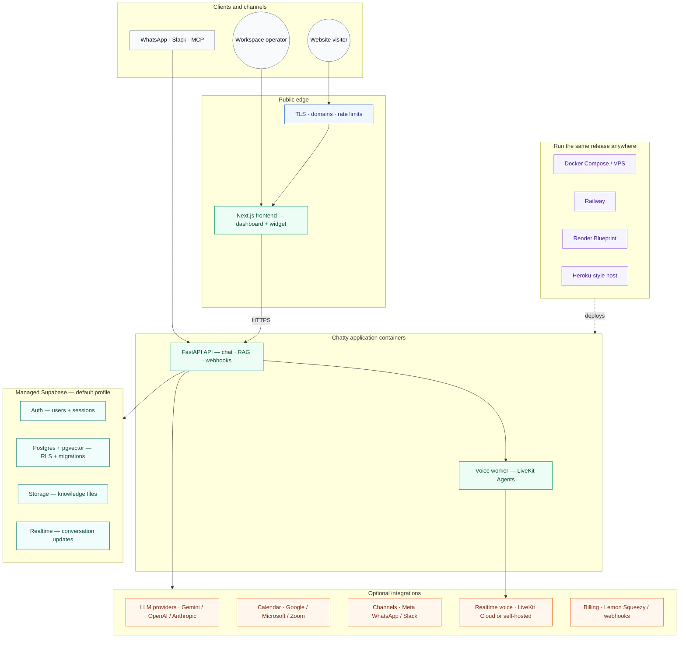

export const metadata = { title: "Self-Hosting & Deploy", description: "Run Chatty's frontend and API containers on Docker, Railway, Render, or Heroku-style platforms while keeping Supabase managed." }

import { Note, Tip, Warning, Info } from "@/components/mdx/Callout"
import { PageNav } from "@/components/PageNav"
import { prevNext } from "@/lib/navigation"

# Self-Hosting & Production Deployment

Chatty's supported self-hosting path moves only the application containers to
your infrastructure. Supabase remains the managed system of record for Auth,
Postgres, Storage, Realtime, pgvector, and row-level security. This preserves
the current data and authentication boundary while allowing the same release
to run on Docker/VPS, Railway, Render, or a Heroku-style container host.

<Info>
The deployment contract is two services: a Next.js frontend and a FastAPI API.
The default root Compose file does not create a second database, Redis, or
object store.
</Info>

## ⚡ 1-Click Cloud Deployment

Deploy the complete Chatty application (backend API + frontend dashboard) directly to cloud platforms:

  
  

<Tip>
**What to prepare before or right after clicking Deploy:**
1. **Create Free Supabase Project:** Go to [supabase.com](https://supabase.com), create a free project, and copy your **Project URL**, **anon key**, **service_role key**, and **Database Connection URI** from Project Settings.
2. **Run Migrations Once:** Run `python scripts/apply_migrations.py "<connection_string>"` from `backend/` (or run SQL files in `backend/supabase/migrations/` in Supabase SQL editor) to provision all 67+ tables and vector schemas.
3. **Get Free Gemini API Key:** Create a key at [aistudio.google.com/apikey](https://aistudio.google.com/apikey).
4. **Enter Variables:** When Render or Railway prompts for environment variables, fill in your Supabase credentials, database host/password, and Gemini key.
</Tip>

## 1. Prerequisites and security boundary

- A Supabase project and database password.
- A GitHub checkout of the [Chatty repository](https://github.com/PersonaliAI/chatty).
- A Gemini key or another configured LLM/BYOK provider.
- One public HTTPS URL for the frontend and one for the API.
- Docker Engine and the Compose plugin for local testing or a VPS.

Use the Supabase publishable key only in the browser and the secret key only
on the API. Supabase explains this split in its
[API key guide](https://supabase.com/docs/guides/getting-started/api-keys).
Never put a secret key, database password, OAuth secret, webhook token,
FUNCTION_SECRET, or BYOK encryption key in the frontend or a committed file.

The provider-neutral self_host profile is a separate advanced deployment. Do
not enable it when you want to keep the current Supabase project.

## 2. Create Supabase and apply migrations

1. Create a project at [supabase.com](https://supabase.com), choose a region
   close to the API, and store the database password in a password manager.
2. In Project Settings → API, copy the project URL, publishable key, and
   server-only secret key.
3. In Project Settings → Database → Connection string, copy the direct or
   session-pooler details. Do not use the transaction pooler for DDL. See
   [database connections](https://supabase.com/docs/guides/database/connecting-to-postgres).
4. In Authentication → URL Configuration, set the final frontend Site URL and
   add the OAuth callback URLs.
5. Apply the schema once, before production traffic:

~~~powershell
git clone https://github.com/PersonaliAI/chatty.git
cd chatty/backend
python -m pip install psycopg2-binary
python scripts/apply_migrations.py "postgresql://postgres:DB_PASSWORD@DB_HOST:5432/postgres"
~~~

## 3. Generate secrets and configure variables

~~~powershell
python -c "import secrets; print(secrets.token_urlsafe(32))"  # FUNCTION_SECRET
python -c "from cryptography.fernet import Fernet; print(Fernet.generate_key().decode())"  # BYOK_ENCRYPTION_KEY
~~~

API variables:

| Variable | Value |
|---|---|
| DEPLOYMENT_PROFILE | managed_supabase |
| SUPABASE_URL | project URL |
| SUPABASE_SECRET_KEY | server-only secret key |
| SUPABASE_DB_HOST | direct/session database host |
| SUPABASE_DB_PASSWORD | database password |
| FUNCTION_SECRET | generated random secret |
| BYOK_ENCRYPTION_KEY | generated Fernet key |
| GEMINI_API_KEY | Google AI Studio key |
| ALLOWED_ORIGINS | exact frontend HTTPS origin |
| FRONTEND_URL | frontend HTTPS origin |
| CHATTY_FRONTEND_URL | frontend HTTPS origin |
| CHATTY_BACKEND_URL | API HTTPS origin |
| PORT | platform-provided value |

Frontend variables:

| Variable | Value |
|---|---|
| NEXT_PUBLIC_SUPABASE_URL | project URL |
| NEXT_PUBLIC_SUPABASE_ANON_KEY | publishable key |
| NEXT_PUBLIC_BACKEND_URL | API HTTPS origin |
| NEXT_PUBLIC_DEPLOYMENT_PROFILE | managed_supabase |
| NEXT_PUBLIC_LEMON_PORTAL_URL | optional public billing URL |

Copy optional channel variables from
[backend/.env.example](https://github.com/PersonaliAI/chatty/blob/main/backend/.env.example).

## 4. Local smoke test

~~~powershell
docker compose up --build -d backend frontend
docker compose ps
curl http://localhost:8000/readyz
~~~

Wait for a ready response, then test sign-up, sign-in, bot creation, knowledge
upload, widget chat, and each integration you enabled. Stop with docker compose
down. The managed Compose file does not create a second Postgres, Redis, or
object store.

## 5. Docker Compose on a VPS

1. Provision Linux, Docker, a firewall, automatic security updates, and a
   non-root deployment user.
2. Clone the repository. Create backend/.env, frontend/.env, and root .env from
   the examples and restrict them:

~~~bash
chmod 600 backend/.env frontend/.env .env
~~~

3. Start the application services:

~~~bash
docker compose up --build -d backend frontend
docker compose ps
curl http://127.0.0.1:8000/readyz
~~~

4. Put Caddy, nginx, or Traefik in front. Route the frontend domain to port
   3000 and API domain to port 8000; terminate TLS at the proxy.
5. Set ALLOWED_ORIGINS, FRONTEND_URL, CHATTY_FRONTEND_URL,
   CHATTY_BACKEND_URL, and NEXT_PUBLIC_BACKEND_URL to final origins.
6. Monitor /readyz and logs. Supabase remains responsible for database and
   storage durability; do not add local database volumes to this profile.

## 6. Railway

Railway maps each Compose service to a separate service. It does not run the
root Compose file as one application. Follow the official
[Compose deployment guide](https://docs.railway.com/guides/docker-compose).

1. Create an Empty project and add a service from the GitHub repository.
2. Select main, set Root Directory to backend, and Dockerfile path to
   Dockerfile. Add API variables in Variables → Raw Editor.
3. Generate api.example.com and set CHATTY_BACKEND_URL. Configure /readyz as
   the healthcheck; Railway injects PORT and waits for a 2xx response. See
   [Dockerfiles](https://docs.railway.com/builds/dockerfiles) and
   [healthchecks](https://docs.railway.com/deployments/healthchecks).
4. Add a second service from the same repository. Set Root Directory to
   frontend and Dockerfile path to Dockerfile.
5. Add NEXT_PUBLIC_SUPABASE_URL, NEXT_PUBLIC_SUPABASE_ANON_KEY,
   NEXT_PUBLIC_BACKEND_URL, and public billing values. These are build-time
   values; changing one rebuilds the frontend. See
   [frontend variables](https://docs.railway.com/guides/frontend-environment-variables).
6. Generate app.example.com and update API CHATTY_FRONTEND_URL, FRONTEND_URL,
   and ALLOWED_ORIGINS. Verify logs, login, bot creation, and widget chat.
   Configure DNS in [Railway Networking](https://docs.railway.com/networking/domains/railway-domains).

## 7. Render

The root render.yaml Blueprint creates chatty-api and chatty-frontend. Render
supports Docker services, HTTP health checks, and sync: false secret prompts
([Blueprint reference](https://render.com/docs/blueprint-spec)).

1. Choose New → Blueprint, connect the repository, and select main.
2. Confirm the two services. Enter all sync: false API secrets and final URLs.
   Never commit secret values to render.yaml; see
   [Infrastructure as Code](https://render.com/docs/infrastructure-as-code).
3. Enter frontend NEXT_PUBLIC_* build values and apply the Blueprint.
4. Wait for chatty-api /readyz to pass. Render routes traffic only after a
   healthy 2xx/3xx probe ([health checks](https://render.com/docs/health-checks)).
5. Attach api.example.com and app.example.com. Update API CORS and Supabase
   Auth redirects.
6. Without Blueprints, create two Web Services manually with runtime Docker,
   root directories backend and frontend, and the same variables. Never put
   sensitive values in Docker build args or image layers
   ([Render Docker](https://render.com/docs/docker)).

## 8. Heroku-style container hosts

Heroku uses one web process per app. Use two apps and keep Supabase external.
The official flow is documented in
[Container Registry & Runtime](https://devcenter.heroku.com/articles/container-registry-and-runtime).

~~~bash
heroku login
heroku container:login

heroku create chatty-api --stack container
heroku config:set DEPLOYMENT_PROFILE=managed_supabase SUPABASE_URL="..." SUPABASE_SECRET_KEY="..." SUPABASE_DB_HOST="..." SUPABASE_DB_PASSWORD="..." FUNCTION_SECRET="..." BYOK_ENCRYPTION_KEY="..." GEMINI_API_KEY="..." ALLOWED_ORIGINS="https://app.example.com" FRONTEND_URL="https://app.example.com" CHATTY_FRONTEND_URL="https://app.example.com" CHATTY_BACKEND_URL="https://api.example.com" --app chatty-api
cd backend
heroku container:push web --app chatty-api
heroku container:release web --app chatty-api
cd ..
heroku domains:add api.example.com --app chatty-api

heroku create chatty-frontend --stack container
heroku config:set NODE_ENV=production NEXT_PUBLIC_SUPABASE_URL="..." NEXT_PUBLIC_SUPABASE_ANON_KEY="sb_publishable_..." NEXT_PUBLIC_BACKEND_URL="https://api.example.com" NEXT_PUBLIC_DEPLOYMENT_PROFILE=managed_supabase --app chatty-frontend
cd frontend
heroku container:push web --app chatty-frontend
heroku container:release web --app chatty-frontend
cd ..
heroku domains:add app.example.com --app chatty-frontend
~~~

Use config vars, not Dockerfile ENV, for credentials. Heroku's filesystem is
ephemeral and Compose networking is unavailable. Read the official
[config vars](https://devcenter.heroku.com/articles/config-vars) and
[custom domains](https://devcenter.heroku.com/articles/custom-domains) guides.

## 9. Verify, update, and roll back safely

1. GET https://api.example.com/readyz returns HTTP 200 and status ready.
2. The frontend loads over HTTPS without mixed-content errors.
3. Supabase sign-up, sign-in, sign-out, password reset, bot creation,
   knowledge upload, and widget chat work.
4. OAuth callbacks, WhatsApp webhook, and Slack request URLs use the API domain.
5. Browser bundles contain only the publishable key; logs contain no secrets.
6. Enable platform alerts, log retention, Supabase backups, and a rollback plan.

Deploy an immutable Git commit. Apply migrations in a controlled release, then
deploy API and frontend. If a container fails health checks, roll back to the
last healthy platform release; do not reset or alter the live Supabase database.
Rotate leaked Supabase keys, FUNCTION_SECRET, BYOK_ENCRYPTION_KEY, OAuth
credentials, and channel tokens through the platform secret manager.

## Troubleshooting

| Symptom | Check |
|---|---|
| API exits during startup | SUPABASE_URL or SUPABASE_SECRET_KEY is missing or a placeholder. |
| /readyz fails | The process is not listening on injected PORT, or Supabase is unreachable. |
| Browser CORS error | ALLOWED_ORIGINS must contain the exact frontend origin. |
| Login redirects to the old site | Update Supabase Auth redirect URLs and CHATTY_FRONTEND_URL. |
| Widget calls the old API | Rebuild after changing NEXT_PUBLIC_BACKEND_URL. |
| Migration cannot connect | Use direct/session connection, not the transaction pooler. |
| Render never becomes live | Confirm Dockerfile CMD and /readyz response. |
| Railway browser failure | Both services need public domains and matching CORS/build values. |
| Heroku app exits | Use platform PORT; do not expect Compose networking or local volumes. |

<PageNav {...prevNext("/guides/self-hosting")} />
