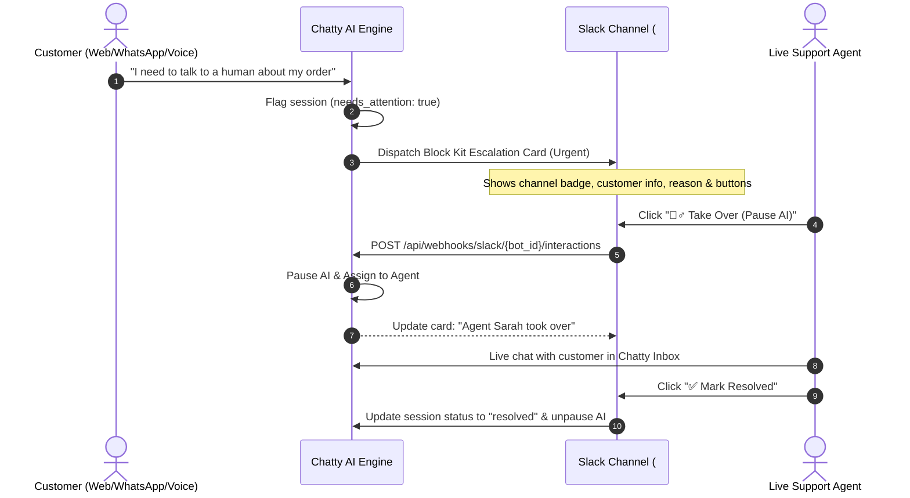

export const metadata = {
  title: "Slack Integration & Escalation Handoff",
  description: "Connect Slack to Chatty for real-time Block Kit escalation alerts, 1-click human agent takeover, direct conversation resolution, and automated workflow notifications."
}

import { Note, Tip, Warning, Info } from "@/components/mdx/Callout"
import { Card, CardGroup } from "@/components/mdx/Card"
import { CodeGroup } from "@/components/mdx/CodeGroup"
import { PageNav } from "@/components/PageNav"
import { prevNext } from "@/lib/navigation"

# Slack Integration & Escalation Handoff

Connect Chatty to your team's Slack workspace to bridge AI customer conversations with your live support team. When a visitor requests a human agent, expresses frustration, or encounters high-stakes edge cases, Chatty posts a rich **Block Kit escalation card** directly to your team's designated Slack channel with **1-click interactive Take Over and Resolve buttons**.



---

## Key Capabilities

<CardGroup cols={2}>
  <Card title="Rich Block Kit Escalation Cards" icon="🚨">
    Instant Slack notifications whenever a customer escalates. Displays customer name, email, omnichannel source badge (Live Chat, WhatsApp, Email, Voice, etc.), ticket ID, priority badge, and the conversation's latest message.
  </Card>
  <Card title="1-Click Interactive Takeover" icon="🙋‍♂️">
    Support agents can click **Take Over (Pause AI)** directly from Slack. Chatty pauses the AI engine, sets status to open, and assigns the agent name immediately.
  </Card>
  <Card title="1-Click Ticket Resolution" icon="✅">
    Once an issue is resolved, click **Mark Resolved** right inside Slack. Chatty updates the session status, unpauses the AI, and logs the agent's name.
  </Card>
  <Card title="Flow Builder Slack Action Nodes" icon="⚡">
    Trigger custom Slack notifications inside Visual Flow Builder (`action.slack`) to notify specific sales or escalation channels with variable templates like `{{data.name}}` and `{{data.email}}`.
  </Card>
  <Card title="Bi-directional Slack Events Streaming" icon="🔄">
    Subscribe your Slack App to receive channel messages and `@mentions`, routing questions directly into the Chatty Omnichannel Inbox.
  </Card>
  <Card title="Cryptographic HMAC Security" icon="🛡️">
    All incoming Slack webhooks and interactivity payloads are cryptographically verified using `v0=HMAC-SHA256` signatures and timestamp replay guards.
  </Card>
</CardGroup>

---

## Setting Up Slack Integration in 3 Steps

### Step 1: Create an Incoming Webhook in Slack

1. Go to your Slack Workspace App Directory and search for **Incoming WebHooks** (or create a Slack App at [api.slack.com/apps](https://api.slack.com/apps)).
2. Click **Add to Slack** and choose the channel where escalation alerts should post (e.g. `#customer-escalations` or `#support`).
3. Copy your **Webhook URL** (formatted as `https://hooks.slack.com/services/T.../B.../...`).

### Step 2: Configure & Test in Chatty Dashboard

1. In Chatty, navigate to **Dashboard → Integrations → Slack**.
2. Paste your Webhook URL into the **Slack Incoming Webhook URL** field.
3. Enter your default notification channel (e.g. `#support`).
4. Click **Save Webhook**.
5. Click **Send Test Alert** to verify connectivity. A verification Block Kit card will appear in your Slack channel within seconds.

### Step 3: Enable Interactive Buttons (Slack Interactivity)

To enable agents to take over conversations or resolve tickets directly from Slack buttons:

1. In your Slack App configuration on [api.slack.com/apps](https://api.slack.com/apps), navigate to **Features → Interactivity & Shortcuts**.
2. Toggle **Interactivity** to **On**.
3. In the **Request URL** field, paste the **Interactive Buttons Request URL** provided in your Chatty Slack integration panel:

```text
https://api.chatty.personaliai.com/api/webhooks/slack/{bot_id}/interactions
```

4. Click **Save Changes**.

---

## Slack Events API (Bi-Directional Messaging)

To stream messages from a Slack channel or respond to `@app_mentions`:

1. In your Slack App, go to **Features → Event Subscriptions**.
2. Toggle **Enable Events** to **On**.
3. In the **Request URL** field, paste:

```text
https://api.chatty.personaliai.com/api/webhooks/slack/{bot_id}/events
```

4. Chatty automatically handles the Slack `url_verification` challenge and returns `HTTP 200`.
5. Under **Subscribe to bot events**, add:
   - `message.channels`: Listens for messages in channels the bot is invited to.
   - `app_mention`: Listens for `@Chatty` mentions in public and private channels.
6. Click **Save Changes** and reinstall your app to the workspace.

<Note>
Chatty automatically detects and ignores bot self-messages and Slack system events to prevent infinite message echo loops.
</Note>

---

## Flow Builder Slack Notifications

You can dispatch targeted Slack alerts at any point in your automation workflows using the **Slack Action Node** (`action.slack`):

1. Open **Dashboard → Visual Flow Builder**.
2. Add an **Action Node** and select **Slack**.
3. Configure the destination channel (e.g. `#vip-sales`) and message template:

```text
🚨 High-Value Lead Alert!
Name: {{data.name}}
Email: {{data.email}}
Company: {{data.company}}
Budget: {{data.budget}}
```

4. Connect the node after qualifying criteria or booking events to instantly notify your team in Slack.

---

## Escalation Triggers Reference

Chatty automatically triggers a Slack escalation alert under any of the following conditions:

| Trigger | Condition | Slack Card Priority |
|---|---|---|
| **Human Request** | Visitor says "talk to human", "real person", "agent please" | `🚨 URGENT` |
| **Negative Sentiment** | Sentiment detector flags sustained frustration, anger, or repeated misunderstandings | `⚠️ HIGH` |
| **Split Shipment** | E-commerce order has items shipping separately across multiple carriers | `⚠️ HIGH` |
| **Partial Refund** | E-commerce order has partial refund lines requiring staff review | `⚠️ HIGH` |
| **SLA Risk** | Unanswered customer message approaches escalation threshold | `🚨 URGENT` |

<PageNav {...prevNext("/guides/slack")} />
