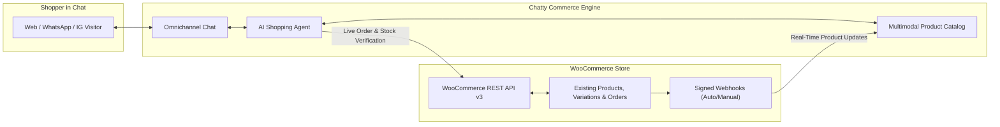

export const metadata = {
  title: "WooCommerce Store Integration",
  description: "Connect an existing or new WooCommerce store to Chatty for 1-click bulk product catalog sync, automatic webhooks, and live order tracking."
}

import { Note, Tip, Warning, Info } from "@/components/mdx/Callout"
import { Card, CardGroup } from "@/components/mdx/Card"
import { CodeGroup } from "@/components/mdx/CodeGroup"
import { PageNav } from "@/components/PageNav"
import { prevNext } from "@/lib/navigation"

# WooCommerce Store Integration

Transform your Chatty AI assistant into a 24/7 e-commerce sales & order support specialist for your WooCommerce store. Chatty connects directly to your WooCommerce REST API v3 to bulk-import your product catalog, answer variant/stock questions with visual product cards, and track customer orders in real time.



---

## Integrating an Already-Selling Store (FAQ)

If you are connecting Chatty to an established WooCommerce store that already has hundreds or thousands of products and past customer orders, **you never need to add products or orders one by one**:

<CardGroup cols={2}>
  <Card title="1. Do I need to enter existing products manually?" icon="🚀">
    **No.** The moment you connect your store, Chatty automatically starts a background **Bulk Catalog Sync** that paginates through your entire published WooCommerce catalog (`100` products per page), expanding variable products (sizes, colors, variant prices, SKUs), stock statuses, sale prices, and gallery images into your AI catalog.
  </Card>
  <Card title="2. What happens to historical orders placed before Chatty?" icon="📦">
    **They work immediately.** Chatty does not require manual order imports. Whenever a customer asks *"Where is my order #1042?"*, Chatty queries your live WooCommerce REST API (`/wp-json/wc/v3/orders`) in real time, verifies the customer's billing email or phone number, and displays live fulfillment and carrier tracking status.
  </Card>
  <Card title="3. Are webhooks configured automatically or manually?" icon="⚡">
    **Both are supported.** When you connect using **Read/Write** REST API keys (or click **Auto-Register Webhooks**), Chatty automatically registers `product.created`, `product.updated`, and `product.deleted` webhooks on your store. If you prefer **Read-Only** API keys, Chatty provides your copyable Webhook URL & HMAC Secret for manual setup.
  </Card>
  <Card title="4. What if a price or stock level changes in WordPress?" icon="🔄">
    **Dual-Layer Freshness.** Signed webhooks update your indexed catalog within seconds of any edit in WordPress, and Chatty also performs a live bounded REST API check on matched products during chat so shoppers never see stale prices or out-of-stock items.
  </Card>
</CardGroup>

---

## Connecting Your WooCommerce Store

Navigate to **Dashboard → Integrations → WooCommerce Store**. You can connect using either **1-Click OAuth** or **Manual REST API Keys**:

### Method A: 1-Click Automatic OAuth (`wc-auth/v1/authorize`)

1. Enter your public HTTPS store URL (e.g. `https://yourstore.com`).
2. Click **Connect with WooCommerce (1-Click)**.
3. Approve the connection screen in your WordPress admin.
4. Chatty immediately saves your encrypted credentials and begins bulk-syncing all existing products in the background.

### Method B: Manual REST API Keys (Recommended for Auto-Webhooks)

Using manual **Read/Write** REST API keys allows Chatty to both bulk-sync your catalog **and** automatically register real-time product webhooks in WooCommerce:

1. In your WordPress Admin, open **WooCommerce → Settings → Advanced → REST API → Add key**.
2. Configure the key:
   - **Description**: `Chatty AI Commerce Sync`
   - **User**: Select an Administrator or Shop Manager account
   - **Permissions**: Select **Read/Write** *(allows automatic webhook creation)* or **Read** *(if you prefer to add webhooks manually)*
3. Click **Generate API key** and copy your **Consumer key (`ck_...`)** and **Consumer secret (`cs_...`)**.
4. In **Chatty Dashboard → Integrations → WooCommerce Store → Manual REST API Keys**, paste your Store URL, Consumer Key, and Consumer Secret, then click **Save & Connect Store**.
5. Chatty verifies your store, auto-registers the product webhooks, and launches the initial bulk product import.

---

## Webhook Configuration: Automatic vs. Manual Setup

### 1. Automatic Webhook Registration

When you connect with **Read/Write** keys (or click the **Auto-Register Webhooks** button in your connected WooCommerce card), Chatty calls `POST /wp-json/wc/v3/webhooks` on your store to register three active HMAC-signed webhooks:
- `Chatty AI Sync (product.created)`
- `Chatty AI Sync (product.updated)`
- `Chatty AI Sync (product.deleted)`

### 2. Manual Webhook Setup (When Using Read-Only Keys)

If your security policy requires **Read-Only** REST API keys, Chatty displays your dedicated **Webhook Delivery URL** and **Webhook Secret** inside **Dashboard → Integrations → WooCommerce Store**:

```text
https://api.chatty.personaliai.com/api/integrations/woocommerce/webhook/{bot_id}
```

To add them manually in WordPress:
1. Go to **WooCommerce → Settings → Advanced → Webhooks** and click **Add webhook**.
2. Configure the webhook:
   - **Name**: `Chatty Product Sync`
   - **Status**: `Active`
   - **Topic**: `Product updated` *(repeat for `Product created` and `Product deleted`)*
   - **Delivery URL**: Paste the **Webhook URL** from Chatty
   - **Secret**: Paste the **Webhook Secret** from Chatty
   - **API Version**: `WP REST API Integration v3`
3. Click **Save webhook**.

---

## Live Order Tracking & Customer Verification

When a shopper asks *"Where is my order #10842?"* in Web Chat, WhatsApp, Instagram, or Messenger:

1. **Identity Verification**: Chatty requires the customer to confirm either the **billing email address** or the **billing phone number** on the order.
2. **Live REST Lookup**: Chatty queries `/wp-json/wc/v3/orders` on your store and inspects shipment tracking metadata (`_wc_shipment_tracking_items`, AfterShip, ShipStation, and per-line-item tracking).
3. **Interactive Order Card**: Once verified, Chatty renders an interactive Order Card showing the order status (`Processing`, `Completed`, `Partially Shipped`, `Refunded`), line items, and direct carrier tracking links (UPS, USPS, FedEx, DHL, Royal Mail, Canada Post, Australia Post).

---

## Read-Only Live WooCommerce REST API Capabilities

Chatty features a dedicated, high-performance Read-Only WooCommerce REST API engine (`/wp-json/wc/v3`) that connects directly to your store without ever requiring write permissions for shopper queries.

All 10 shopper-facing endpoint categories are fully supported with strict server-side security:

### 1. Products (Public & Customer-Facing)
- `GET /products`: List products with server-side filtering.
- `GET /products/{id}`: Live product details, dimensions, weight, stock quantity, and gallery images.
- `GET /products?sku={sku}`: Exact and partial SKU lookup.
- `GET /products?category={id}`: Filter products by category ID or slug.
- `GET /products?tag={id}`: Filter products by tag ID or slug.
- `GET /products?search={query}`: Keyword and title search.
- `GET /products?featured=true`: Filter store featured products.
- `GET /products?on_sale=true`: Filter active sale/discounted items.
- `GET /products?stock_status=instock`: Filter available in-stock items.
- `GET /products?orderby=popularity`: Top-selling products.
- `GET /products?orderby=rating`: Top-rated products based on customer reviews.
- `GET /products?orderby=date`: Latest and newly arrived products.

### 2. Product Variations
- `GET /products/{id}/variations`: List all sellable variations for variable products (sizes, colors, materials, prices, and stock counts).
- `GET /products/{id}/variations/{variation_id}`: Inspect specific variation details, variant SKUs, and variant-specific pricing.

### 3. Categories
- `GET /products/categories`: All public product categories and product counts.
- `GET /products/categories/{id}`: Category details, description, and hierarchy.

### 4. Product Attributes & Terms
- `GET /products/attributes`: List global product attributes (e.g., Size, Color, Material, Brand).
- `GET /products/attributes/{id}`: Specific attribute details.
- `GET /products/attributes/{id}/terms`: Available options/values for an attribute (e.g., XS, S, M, L, XL).
- `GET /products/attributes/{id}/terms/{term_id}`: Details for an individual attribute option.

### 5. Product Tags
- `GET /products/tags`: List product tags.
- `GET /products/tags/{id}`: Specific tag details and item counts.

### 6. Product Reviews & Ratings
- `GET /products/reviews`: Approved customer reviews.
- `GET /products/reviews/{id}`: Specific review details.
- `GET /products/{id}`: Aggregate average rating and review counts.

### 7. Shipping Information (Sanitized Safe View)
- `GET /shipping/zones`: Available shipping zones and regions.
- `GET /shipping/zones/{id}`: Zone details.
- `GET /shipping/zones/{id}/locations`: Covered countries, states, and postal codes.
- `GET /shipping/zones/{id}/methods`: Shipping methods, flat rates, and free shipping minimum order amounts.
- `GET /products/shipping_classes`: Store shipping classes (e.g., Heavy items, Express parcel).

### 8. Payment Information (Sanitized Safe View)
- `GET /payment_gateways`: Active checkout payment gateways (e.g., Stripe, PayPal, COD, Klarna).
- `GET /payment_gateways/{id}`: Gateway details and supported features.
- **Security**: All internal credentials, webhook secrets, and private API keys are strictly stripped before returning data to the AI agent or customer.

### 9. Customer-Specific Endpoints (Strict Server-Side Verification)
- `GET /customers/{id}`: Customer profile and order history count.
- `GET /orders`: Recent customer orders.
- `GET /orders/{id}`: Order details, line items, and fulfillment tracking numbers.
- `GET /orders/{id}/notes`: Customer-visible merchant notes only (internal private staff notes are strictly excluded).
- `GET /orders/{id}/refunds`: Itemized refund records and reasons.
- `GET /orders/{id}/shipping`: Carrier shipping details and package tracking links.
- **Security Rule**: Chatty strictly forbids arbitrary order or customer ID lookups. The caller's billing email or phone number is always required and cryptographically matched against the order record before disclosing any order details.

### 10. Coupons & Promotions
- `GET /coupons?code={code}`: Verify a specific promo code, discount type (percentage vs. fixed), minimum spend, and expiry date.
- `GET /coupons/{id}`: Individual coupon details.
- **Anti-Enumeration Guard**: Listing all store coupons is strictly disabled for unauthenticated users to prevent discount code harvesting. Validation is informational; final coupon redemption is completed during checkout.

---

## Agent Tool Directives

Chatty's AI agent uses four specialized tools to interact with your WooCommerce store in real time:

1. `search_woocommerce_products`: Filters by price range (`min_price`, `max_price`), on-sale items (`on_sale=true`), featured items, categories, tags, SKUs, and sorting orders (`popularity`, `rating`, `date`, `price_asc`, `price_desc`).
2. `get_woocommerce_store_info`: Inspects live store metadata across categories, tags, attributes, reviews, shipping rates, payment methods, and coupon verification.
3. `lookup_woocommerce_order`: Verifies customer billing email/phone and displays verified order tracking cards with clickable carrier tracking links.
4. `lookup_woocommerce_customer`: Looks up customer profiles with mandatory server-side email/phone ownership verification.

<PageNav {...prevNext("/guides/woocommerce")} />
